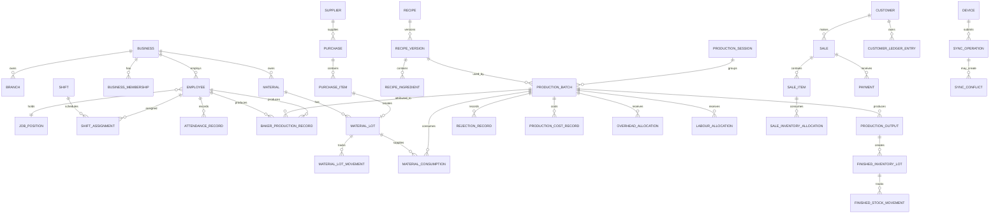

# DATABASE.md — Injera Business Manager

**Version:** 1.0  
**Status:** Proposed database design  
**Database:** PostgreSQL  
**ORM:** Prisma  
**Currency:** Ethiopian Birr (ETB)  
**Architecture:** Multi-tenant modular monolith

---

# 1. Database Design Principles

The database must support:

1. Multiple businesses and branches.
2. Strict tenant isolation.
3. Employee and workforce management.
4. Day, night and custom shifts.
5. Individual baker productivity tracking.
6. Material purchases and specific purchase lots.
7. Recipe versioning and mixed-teff blending.
8. Production sessions containing multiple batches.
9. Actual production consumption and output.
10. Rejection and wastage tracking.
11. Accurate production costing.
12. Direct and shared labour allocation.
13. Raw and finished inventory.
14. Sales, customer credit and payments.
15. Expenses and financial reporting.
16. Offline transactions and synchronization.
17. Auditability and historical data preservation.

## 1.1 General conventions

| Convention          | Decision                                                                 |
| ------------------- | ------------------------------------------------------------------------ |
| Primary identifiers | UUID                                                                     |
| Currency            | ETB                                                                      |
| Monetary values     | Decimal / PostgreSQL NUMERIC                                             |
| Precise quantities  | Decimal / PostgreSQL NUMERIC                                             |
| Timestamps          | Timezone-aware                                                           |
| Database naming     | Consistent snake_case                                                    |
| API naming          | camelCase                                                                |
| Tenant ownership    | businessId                                                               |
| Branch ownership    | branchId where applicable                                                |
| Deletion            | Soft deactivation for master data; reversals for financial/stock history |

Do not use floating-point types for monetary calculations.

Use explicit decimal precision and scale based on the maximum quantities and monetary values supported by the business.

---

# 2. Database Modules

The database is organized into these logical modules:

1. Identity and tenancy
2. Workforce and shifts
3. Materials and purchasing
4. Recipes and teff blending
5. Production
6. Labour and production costing
7. Inventory
8. Customers and sales
9. Finance
10. Dashboard customization
11. Offline synchronization
12. Audit and system configuration

---

# 3. Identity and Multi-Tenancy

## 3.1 Business

Represents a registered injera business.

**Table: `businesses`**

| Field        | Type         | Constraints                 |
| ------------ | ------------ | --------------------------- |
| id           | UUID         | PK                          |
| name         | VARCHAR(200) | Required                    |
| legalName    | VARCHAR(200) | Nullable                    |
| phone        | VARCHAR(30)  | Nullable                    |
| email        | VARCHAR(255) | Nullable                    |
| address      | TEXT         | Nullable                    |
| currency     | VARCHAR(3)   | Default ETB                 |
| timezone     | VARCHAR(100) | Required                    |
| dateCalendar | ENUM         | GREGORIAN / ETHIOPIAN       |
| status       | ENUM         | ACTIVE / SUSPENDED / CLOSED |
| createdAt    | TIMESTAMP    | Required                    |
| updatedAt    | TIMESTAMP    | Required                    |

Relationships:

- One business has many branches.
- One business has many memberships.
- One business owns its operational records.
- One business has many employees, materials, suppliers and customers.

## 3.2 Branch

**Table: `branches`**

| Field      | Type         | Constraints            |
| ---------- | ------------ | ---------------------- |
| id         | UUID         | PK                     |
| businessId | UUID         | FK                     |
| name       | VARCHAR(150) | Required               |
| code       | VARCHAR(50)  | Unique within business |
| address    | TEXT         | Nullable               |
| phone      | VARCHAR(30)  | Nullable               |
| isMain     | BOOLEAN      | Default false          |
| status     | ENUM         | ACTIVE / INACTIVE      |
| createdAt  | TIMESTAMP    | Required               |
| updatedAt  | TIMESTAMP    | Required               |

A branch represents a production location, shop, warehouse or distribution location.

## 3.3 User

Authentication identities are separate from employee profiles.

**Table: `users`**

| Field                | Type             | Constraints             |
| -------------------- | ---------------- | ----------------------- |
| id                   | UUID             | PK                      |
| name                 | VARCHAR(150)     | Required                |
| email                | VARCHAR(255)     | Unique where applicable |
| phone                | VARCHAR(30)      | Nullable                |
| password/auth fields | Provider-managed | Depends on Better Auth  |
| createdAt            | TIMESTAMP        | Required                |
| updatedAt            | TIMESTAMP        | Required                |

Better Auth may require additional provider-specific tables. Do not manually replace its required schema.

## 3.4 BusinessMembership

**Table: `business_memberships`**

| Field      | Type      | Constraints                  |
| ---------- | --------- | ---------------------------- |
| id         | UUID      | PK                           |
| businessId | UUID      | FK                           |
| userId     | UUID      | FK                           |
| roleId     | UUID      | FK                           |
| status     | ENUM      | INVITED / ACTIVE / SUSPENDED |
| createdAt  | TIMESTAMP | Required                     |
| updatedAt  | TIMESTAMP | Required                     |

Unique constraint:

`businessId + userId`

## 3.5 Roles and Permissions

**Tables:**

- `roles`
- `permissions`
- `role_permissions`
- `membership_branch_access`

Roles are business-scoped where custom roles are supported.

Suggested default roles:

- OWNER
- ADMIN
- MANAGER
- SUPERVISOR
- BAKER
- LABOURER
- CASHIER
- DISTRIBUTOR
- VIEWER

Do not rely on these role names alone for authorization. Use explicit permissions.

Example permissions:

- `employee.read`
- `employee.create`
- `employee.update`
- `attendance.manage`
- `production.create`
- `production.finalize`
- `production.cost.read`
- `inventory.adjust`
- `sales.create`
- `customer.payment.record`
- `finance.report.read`
- `business.settings.manage`

---

# 4. Workforce and Employee Management

This module is important because the application must track employee headcount, labour, baker productivity and shifts.

## 4.1 Employee

**Table: `employees`**

| Field           | Type         | Constraints                                  |
| --------------- | ------------ | -------------------------------------------- |
| id              | UUID         | PK                                           |
| businessId      | UUID         | FK                                           |
| branchId        | UUID         | FK                                           |
| userId          | UUID         | Nullable FK                                  |
| employeeNumber  | VARCHAR(50)  | Unique within business                       |
| firstName       | VARCHAR(100) | Required                                     |
| lastName        | VARCHAR(100) | Required                                     |
| phone           | VARCHAR(30)  | Nullable                                     |
| address         | TEXT         | Nullable                                     |
| positionId      | UUID         | FK                                           |
| employmentType  | ENUM         | FULL_TIME / PART_TIME / TEMPORARY / CONTRACT |
| hireDate        | DATE         | Required                                     |
| terminationDate | DATE         | Nullable                                     |
| status          | ENUM         | ACTIVE / INACTIVE / TERMINATED               |
| createdAt       | TIMESTAMP    | Required                                     |
| updatedAt       | TIMESTAMP    | Required                                     |

An employee may exist without a login account.

## 4.2 Department

**Table: `departments`**

| Field       | Type         | Constraints  |
| ----------- | ------------ | ------------ |
| id          | UUID         | PK           |
| businessId  | UUID         | FK           |
| name        | VARCHAR(100) | Required     |
| description | TEXT         | Nullable     |
| isActive    | BOOLEAN      | Default true |

Examples:

- Production
- Distribution
- Finance
- Administration
- Sales

## 4.3 JobPosition

**Table: `job_positions`**

| Field        | Type         | Constraints  |
| ------------ | ------------ | ------------ |
| id           | UUID         | PK           |
| businessId   | UUID         | FK           |
| name         | VARCHAR(100) | Required     |
| departmentId | UUID         | Nullable FK  |
| description  | TEXT         | Nullable     |
| isActive     | BOOLEAN      | Default true |

Example positions:

- Baker
- Labourer
- Production Assistant
- Cleaner
- Cashier
- Distributor
- Supervisor
- Manager

Positions must be configurable, not hardcoded into the database schema.

## 4.4 Shift

**Table: `shifts`**

| Field           | Type         | Constraints          |
| --------------- | ------------ | -------------------- |
| id              | UUID         | PK                   |
| businessId      | UUID         | FK                   |
| branchId        | UUID         | FK                   |
| name            | VARCHAR(100) | Required             |
| shiftType       | ENUM         | DAY / NIGHT / CUSTOM |
| startTime       | TIME         | Required             |
| endTime         | TIME         | Required             |
| crossesMidnight | BOOLEAN      | Required             |
| breakMinutes    | INTEGER      | Default 0            |
| isActive        | BOOLEAN      | Default true         |
| createdAt       | TIMESTAMP    | Required             |

Example:

| Shift | Start | End   |
| ----- | ----- | ----- |
| Day   | 06:00 | 18:00 |
| Night | 18:00 | 06:00 |

A night shift crossing midnight must be represented as one shift, not two unrelated shifts.

## 4.5 ShiftAssignment

**Table: `shift_assignments`**

| Field          | Type      | Constraints                       |
| -------------- | --------- | --------------------------------- |
| id             | UUID      | PK                                |
| businessId     | UUID      | FK                                |
| branchId       | UUID      | FK                                |
| employeeId     | UUID      | FK                                |
| shiftId        | UUID      | FK                                |
| scheduledStart | TIMESTAMP | Required                          |
| scheduledEnd   | TIMESTAMP | Required                          |
| assignedById   | UUID      | Nullable FK                       |
| status         | ENUM      | SCHEDULED / CONFIRMED / CANCELLED |
| createdAt      | TIMESTAMP | Required                          |

Validate that scheduledEnd is later than scheduledStart.

Prevent overlapping confirmed assignments for the same employee unless an authorized exception is recorded.

## 4.6 Attendance

**Table: `attendance_records`**

| Field             | Type      | Constraints                                |
| ----------------- | --------- | ------------------------------------------ |
| id                | UUID      | PK                                         |
| businessId        | UUID      | FK                                         |
| branchId          | UUID      | FK                                         |
| employeeId        | UUID      | FK                                         |
| shiftAssignmentId | UUID      | Nullable FK                                |
| operationalDate   | DATE      | Required                                   |
| clockIn           | TIMESTAMP | Nullable                                   |
| clockOut          | TIMESTAMP | Nullable                                   |
| breakMinutes      | INTEGER   | Default 0                                  |
| overtimeMinutes   | INTEGER   | Default 0                                  |
| status            | ENUM      | PRESENT / ABSENT / LATE / LEAVE / HALF_DAY |
| notes             | TEXT      | Nullable                                   |
| recordedById      | UUID      | Nullable FK                                |
| createdAt         | TIMESTAMP | Required                                   |
| updatedAt         | TIMESTAMP | Required                                   |

Actual attendance must remain separate from scheduled shifts.

For overnight shifts, `operationalDate` identifies the date on which the shift started.

## 4.7 EmployeeCompensation

**Table: `employee_compensations`**

| Field            | Type      | Constraints                          |
| ---------------- | --------- | ------------------------------------ |
| id               | UUID      | PK                                   |
| businessId       | UUID      | FK                                   |
| employeeId       | UUID      | FK                                   |
| compensationType | ENUM      | HOURLY / DAILY / PER_SHIFT / MONTHLY |
| rate             | DECIMAL   | Required                             |
| effectiveFrom    | DATE      | Required                             |
| effectiveTo      | DATE      | Nullable                             |
| createdAt        | TIMESTAMP | Required                             |

Compensation records are effective-dated. A future wage change must not change finalized historical labour costs.

## 4.8 BakerProductionRecord

**Table: `baker_production_records`**

This table records how many injera an individual baker produced.

| Field               | Type      | Constraints                              |
| ------------------- | --------- | ---------------------------------------- |
| id                  | UUID      | PK                                       |
| businessId          | UUID      | FK                                       |
| branchId            | UUID      | FK                                       |
| employeeId          | UUID      | FK                                       |
| productionSessionId | UUID      | FK                                       |
| productionBatchId   | UUID      | FK                                       |
| shiftAssignmentId   | UUID      | Nullable FK                              |
| productId           | UUID      | FK                                       |
| operationalDate     | DATE      | Required                                 |
| totalProduced       | INTEGER   | Required                                 |
| acceptedQuantity    | INTEGER   | Required                                 |
| rejectedQuantity    | INTEGER   | Required                                 |
| attributionMethod   | ENUM      | INDIVIDUAL_COUNT / SUPERVISOR_ALLOCATION |
| recordedById        | UUID      | Nullable FK                              |
| approvedById        | UUID      | Nullable FK                              |
| notes               | TEXT      | Nullable                                 |
| createdAt           | TIMESTAMP | Required                                 |

Invariant:

`totalProduced = acceptedQuantity + rejectedQuantity`

Baker attribution must reconcile with the batch's team output.

Do not assign the full batch output to every baker participating in that batch.

If output cannot be attributed to an individual, explicitly represent the unallocated amount through a suitable production attribution record.

## 4.9 LeaveRecord

**Table: `leave_records`**

| Field        | Type        | Constraints                   |
| ------------ | ----------- | ----------------------------- |
| id           | UUID        | PK                            |
| businessId   | UUID        | FK                            |
| employeeId   | UUID        | FK                            |
| leaveType    | VARCHAR(50) | Required                      |
| startDate    | DATE        | Required                      |
| endDate      | DATE        | Required                      |
| reason       | TEXT        | Nullable                      |
| status       | ENUM        | PENDING / APPROVED / REJECTED |
| approvedById | UUID        | Nullable FK                   |

---

# 5. Materials and Purchasing

## 5.1 MaterialCategory

**Table: `material_categories`**

| Field       | Type         |
| ----------- | ------------ |
| id          | UUID         |
| businessId  | UUID         |
| name        | VARCHAR(100) |
| description | TEXT         |
| isActive    | BOOLEAN      |

Examples:

- Teff
- Other Ingredients
- Water
- Consumables
- Packaging
- Custom

## 5.2 UnitOfMeasure

**Table: `units_of_measure`**

| Field      | Type                                |
| ---------- | ----------------------------------- |
| id         | UUID                                |
| businessId | UUID                                |
| name       | VARCHAR(50)                         |
| symbol     | VARCHAR(20)                         |
| dimension  | ENUM: MASS / VOLUME / COUNT / OTHER |
| isBaseUnit | BOOLEAN                             |

Examples: kg, g, litre, ml, piece.

Unit conversion records must identify the source unit, target unit and conversion factor. Do not infer mass-to-volume conversions.

## 5.3 Material

**Table: `materials`**

| Field         | Type         |
| ------------- | ------------ |
| id            | UUID         |
| businessId    | UUID         |
| categoryId    | UUID         |
| name          | VARCHAR(150) |
| defaultUnitId | UUID         |
| minimumStock  | DECIMAL      |
| isActive      | BOOLEAN      |
| createdAt     | TIMESTAMP    |

Examples: White Teff, Red Teff, Water, Salt, Packaging.

Teff varieties must be configurable.

## 5.4 MaterialType / Variety

If varieties need independent metadata, use:

**Table: `material_varieties`**

| Field       | Type         |
| ----------- | ------------ |
| id          | UUID         |
| businessId  | UUID         |
| materialId  | UUID         |
| name        | VARCHAR(100) |
| description | TEXT         |
| isActive    | BOOLEAN      |

## 5.5 Supplier

**Table: `suppliers`**

| Field         | Type                    |
| ------------- | ----------------------- |
| id            | UUID                    |
| businessId    | UUID                    |
| name          | VARCHAR(150)            |
| phone         | VARCHAR(30)             |
| address       | TEXT                    |
| contactPerson | VARCHAR(150)            |
| status        | ENUM: ACTIVE / INACTIVE |
| createdAt     | TIMESTAMP               |

## 5.6 Purchase

**Table: `purchases`**

| Field           | Type                               |
| --------------- | ---------------------------------- |
| id              | UUID                               |
| businessId      | UUID                               |
| branchId        | UUID                               |
| supplierId      | UUID                               |
| purchaseNumber  | VARCHAR(50)                        |
| purchaseDate    | TIMESTAMP                          |
| totalAmount     | DECIMAL                            |
| acquisitionCost | DECIMAL                            |
| paymentStatus   | ENUM: UNPAID / PARTIAL / PAID      |
| status          | ENUM: DRAFT / RECEIVED / CANCELLED |
| createdById     | UUID                               |
| createdAt       | TIMESTAMP                          |

Unique constraint: `businessId + purchaseNumber`.

## 5.7 PurchaseItem

**Table: `purchase_items`**

| Field                    | Type           |
| ------------------------ | -------------- |
| id                       | UUID           |
| businessId               | UUID           |
| purchaseId               | UUID           |
| materialId               | UUID           |
| varietyId                | UUID, nullable |
| grossQuantity            | DECIMAL        |
| tareQuantity             | DECIMAL        |
| unusableQuantity         | DECIMAL        |
| usableQuantity           | DECIMAL        |
| unitId                   | UUID           |
| purchaseCost             | DECIMAL        |
| allocatedAcquisitionCost | DECIMAL        |
| unitCost                 | DECIMAL        |

Formula:

`usableQuantity = grossQuantity - tareQuantity - unusableQuantity`

`unitCost = (purchaseCost + allocatedAcquisitionCost) / usableQuantity`

The usable quantity must be positive.

## 5.8 MaterialLot

**Table: `material_lots`**

| Field                | Type                                           |
| -------------------- | ---------------------------------------------- |
| id                   | UUID                                           |
| businessId           | UUID                                           |
| branchId             | UUID                                           |
| materialId           | UUID                                           |
| varietyId            | UUID, nullable                                 |
| purchaseItemId       | UUID, nullable                                 |
| blendOperationId     | UUID, nullable                                 |
| lotNumber            | VARCHAR(100)                                   |
| originalQuantity     | DECIMAL                                        |
| remainingQuantity    | DECIMAL                                        |
| unitId               | UUID                                           |
| totalAcquisitionCost | DECIMAL                                        |
| unitCost             | DECIMAL                                        |
| receivedAt           | TIMESTAMP                                      |
| expiryDate           | DATE, nullable                                 |
| status               | ENUM: AVAILABLE / DEPLETED / BLOCKED / EXPIRED |

Each received purchase item creates a distinct lot.

Blend lots are created by blending operations and retain their source ancestry.

## 5.9 MaterialLotMovement

**Table: `material_lot_movements`**

| Field            | Type        |
| ---------------- | ----------- |
| id               | UUID        |
| businessId       | UUID        |
| materialLotId    | UUID        |
| movementType     | ENUM        |
| quantity         | DECIMAL     |
| unitCostSnapshot | DECIMAL     |
| totalCost        | DECIMAL     |
| referenceType    | VARCHAR(50) |
| referenceId      | UUID        |
| occurredAt       | TIMESTAMP   |
| createdById      | UUID        |

Movement types:

- PURCHASE_RECEIPT
- PRODUCTION_CONSUMPTION
- BLEND_INPUT
- BLEND_OUTPUT
- ADJUSTMENT_IN
- ADJUSTMENT_OUT
- TRANSFER_IN
- TRANSFER_OUT
- REVERSAL

Stock balances must reconcile to movement history.

---

# 6. Recipes and Teff Blending

## 6.1 Recipe

**Table: `recipes`**

| Field       | Type                    |
| ----------- | ----------------------- |
| id          | UUID                    |
| businessId  | UUID                    |
| branchId    | UUID, nullable          |
| name        | VARCHAR(150)            |
| productId   | UUID                    |
| description | TEXT                    |
| status      | ENUM: ACTIVE / INACTIVE |
| createdAt   | TIMESTAMP               |

## 6.2 RecipeVersion

**Table: `recipe_versions`**

| Field                  | Type      |
| ---------------------- | --------- |
| id                     | UUID      |
| businessId             | UUID      |
| recipeId               | UUID      |
| versionNumber          | INTEGER   |
| referenceBatchQuantity | DECIMAL   |
| expectedYield          | DECIMAL   |
| instructions           | TEXT      |
| effectiveFrom          | DATE      |
| createdById            | UUID      |
| createdAt              | TIMESTAMP |

Unique constraint: `recipeId + versionNumber`.

Recipe changes create a new version. Historical production batches retain the original version.

## 6.3 RecipeIngredient

**Table: `recipe_ingredients`**

| Field            | Type           |
| ---------------- | -------------- |
| id               | UUID           |
| businessId       | UUID           |
| recipeVersionId  | UUID           |
| materialId       | UUID           |
| varietyId        | UUID, nullable |
| expectedQuantity | DECIMAL        |
| unitId           | UUID           |
| notes            | TEXT           |

## 6.4 BlendOperation

**Table: `blend_operations`**

| Field           | Type                                |
| --------------- | ----------------------------------- |
| id              | UUID                                |
| businessId      | UUID                                |
| branchId        | UUID                                |
| operationNumber | VARCHAR(50)                         |
| operationDate   | TIMESTAMP                           |
| outputQuantity  | DECIMAL                             |
| processingLoss  | DECIMAL                             |
| processingCost  | DECIMAL                             |
| status          | ENUM: DRAFT / COMPLETED / CANCELLED |
| createdById     | UUID                                |

## 6.5 BlendInput

**Table: `blend_inputs`**

| Field            | Type    |
| ---------------- | ------- |
| id               | UUID    |
| businessId       | UUID    |
| blendOperationId | UUID    |
| materialLotId    | UUID    |
| quantityConsumed | DECIMAL |
| unitCostSnapshot | DECIMAL |
| totalCost        | DECIMAL |

One blend can consume multiple source lots.

## 6.6 BlendOutput

**Table: `blend_outputs`**

| Field            | Type    |
| ---------------- | ------- |
| id               | UUID    |
| businessId       | UUID    |
| blendOperationId | UUID    |
| materialLotId    | UUID    |
| outputQuantity   | DECIMAL |
| totalCost        | DECIMAL |
| unitCost         | DECIMAL |

A completed blend creates a traceable new material lot.

---

# 7. Production

## 7.1 ProductionSession

**Table: `production_sessions`**

| Field             | Type                                              |
| ----------------- | ------------------------------------------------- |
| id                | UUID                                              |
| businessId        | UUID                                              |
| branchId          | UUID                                              |
| sessionNumber     | VARCHAR(50)                                       |
| operationalDate   | DATE                                              |
| startTime         | TIMESTAMP                                         |
| endTime           | TIMESTAMP                                         |
| shiftAssignmentId | UUID, nullable                                    |
| supervisorId      | UUID                                              |
| status            | ENUM: DRAFT / IN_PROGRESS / COMPLETED / CANCELLED |
| notes             | TEXT                                              |
| createdAt         | TIMESTAMP                                         |

A session groups one or more production batches.

## 7.2 ProductionBatch

**Table: `production_batches`**

| Field               | Type                                              |
| ------------------- | ------------------------------------------------- |
| id                  | UUID                                              |
| businessId          | UUID                                              |
| productionSessionId | UUID                                              |
| recipeId            | UUID                                              |
| recipeVersionId     | UUID                                              |
| batchNumber         | VARCHAR(50)                                       |
| plannedQuantity     | DECIMAL                                           |
| actualOutput        | DECIMAL                                           |
| acceptedOutput      | DECIMAL                                           |
| rejectedOutput      | DECIMAL                                           |
| startTime           | TIMESTAMP                                         |
| endTime             | TIMESTAMP                                         |
| status              | ENUM: DRAFT / IN_PROGRESS / COMPLETED / CANCELLED |
| finalizedAt         | TIMESTAMP, nullable                               |
| finalizedById       | UUID, nullable                                    |

A batch references one recipe version and can consume multiple material lots.

## 7.3 BatchEmployeeAssignment

**Table: `batch_employee_assignments`**

| Field             | Type                                        |
| ----------------- | ------------------------------------------- |
| id                | UUID                                        |
| businessId        | UUID                                        |
| productionBatchId | UUID                                        |
| employeeId        | UUID                                        |
| assignmentRole    | ENUM: BAKER / LABOURER / SUPERVISOR / OTHER |
| assignedStart     | TIMESTAMP                                   |
| assignedEnd       | TIMESTAMP, nullable                         |
| notes             | TEXT                                        |

This records participation. It does not itself determine the baker's output quantity.

## 7.4 MaterialConsumption

**Table: `material_consumptions`**

| Field             | Type      |
| ----------------- | --------- |
| id                | UUID      |
| businessId        | UUID      |
| productionBatchId | UUID      |
| materialLotId     | UUID      |
| actualQuantity    | DECIMAL   |
| unitId            | UUID      |
| unitCostSnapshot  | DECIMAL   |
| totalCost         | DECIMAL   |
| consumedAt        | TIMESTAMP |

The same batch may consume multiple lots of the same material.

The lot-specific unit cost is snapshotted for historical costing.

## 7.5 FinishedProduct

**Table: `finished_products`**

| Field               | Type                   |
| ------------------- | ---------------------- |
| id                  | UUID                   |
| businessId          | UUID                   |
| name                | VARCHAR(150)           |
| productCode         | VARCHAR(50)            |
| size                | VARCHAR(100), nullable |
| unitId              | UUID                   |
| defaultSellingPrice | DECIMAL                |
| isActive            | BOOLEAN                |

Examples: Standard Injera, Large Injera, Small Injera.

## 7.6 ProductionOutput

**Table: `production_outputs`**

| Field             | Type    |
| ----------------- | ------- |
| id                | UUID    |
| businessId        | UUID    |
| productionBatchId | UUID    |
| productId         | UUID    |
| totalQuantity     | INTEGER |
| acceptedQuantity  | INTEGER |
| rejectedQuantity  | INTEGER |
| allocationMethod  | ENUM    |
| allocatedCost     | DECIMAL |
| unitCost          | DECIMAL |

Invariant:

`totalQuantity = acceptedQuantity + rejectedQuantity`

One batch may produce multiple finished products.

## 7.7 RejectionRecord

**Table: `rejection_records`**

| Field              | Type           |
| ------------------ | -------------- |
| id                 | UUID           |
| businessId         | UUID           |
| productionBatchId  | UUID           |
| productionOutputId | UUID, nullable |
| employeeId         | UUID, nullable |
| reason             | ENUM           |
| quantity           | INTEGER        |
| notes              | TEXT           |
| evidenceReference  | TEXT, nullable |
| recordedAt         | TIMESTAMP      |

Reasons:

- BURNT
- TORN_DAMAGED
- INCORRECT_THICKNESS
- INCORRECT_SIZE
- CONTAMINATION
- OTHER

Support aggregate rejection totals even when individual rejection details are not recorded.

Rejected output never enters sellable inventory.

---

# 8. Labour and Production Costing

## 8.1 OverheadRecord

**Table: `overhead_records`**

| Field             | Type                              |
| ----------------- | --------------------------------- |
| id                | UUID                              |
| businessId        | UUID                              |
| branchId          | UUID                              |
| productionBatchId | UUID, nullable                    |
| operationalDate   | DATE                              |
| category          | ENUM                              |
| amount            | DECIMAL                           |
| paymentMethod     | VARCHAR(50), nullable             |
| allocationType    | ENUM: DIRECT_BATCH / DAILY_SHARED |
| description       | TEXT                              |
| sourceReference   | VARCHAR(150), nullable            |
| createdById       | UUID                              |

Categories:

- LABOUR
- FUEL
- FIREWOOD
- ELECTRICITY
- WATER
- PACKAGING
- OTHER

General operating expenses should not be stored here unless they are explicitly classified as production overhead.

## 8.2 OverheadAllocation

**Table: `overhead_allocations`**

| Field                | Type      |
| -------------------- | --------- |
| id                   | UUID      |
| businessId           | UUID      |
| overheadRecordId     | UUID      |
| productionBatchId    | UUID      |
| allocationMethod     | ENUM      |
| allocationPercentage | DECIMAL   |
| allocatedAmount      | DECIMAL   |
| createdAt            | TIMESTAMP |

Allocation methods:

- PRODUCTION_QUANTITY
- PRODUCTION_TIME
- DIRECT_MATERIAL_COST
- MANUAL_PERCENTAGE

The total allocated amount must equal the allocatable overhead source amount.

## 8.3 LabourCostRecord

**Table: `labour_cost_records`**

| Field                    | Type                                      |
| ------------------------ | ----------------------------------------- |
| id                       | UUID                                      |
| businessId               | UUID                                      |
| branchId                 | UUID                                      |
| employeeId               | UUID                                      |
| attendanceRecordId       | UUID, nullable                            |
| operationalDate          | DATE                                      |
| workedMinutes            | INTEGER                                   |
| compensationTypeSnapshot | ENUM                                      |
| rateSnapshot             | DECIMAL                                   |
| totalLabourCost          | DECIMAL                                   |
| status                   | ENUM: UNALLOCATED / ALLOCATED / FINALIZED |

Labour cost is calculated from compensation and eligible work time or the applicable compensation method.

## 8.4 LabourAllocation

**Table: `labour_allocations`**

| Field              | Type      |
| ------------------ | --------- |
| id                 | UUID      |
| businessId         | UUID      |
| labourCostRecordId | UUID      |
| productionBatchId  | UUID      |
| allocatedMinutes   | INTEGER   |
| allocatedAmount    | DECIMAL   |
| allocationMethod   | ENUM      |
| createdAt          | TIMESTAMP |

Prevent the same labour cost from being counted both as direct batch labour and shared overhead.

## 8.5 ProductionCostRecord

**Table: `production_cost_records`**

| Field                  | Type                |
| ---------------------- | ------------------- |
| id                     | UUID                |
| businessId             | UUID                |
| productionBatchId      | UUID                |
| materialCost           | DECIMAL             |
| directOverheadCost     | DECIMAL             |
| allocatedDailyOverhead | DECIMAL             |
| allocatedLabourCost    | DECIMAL             |
| totalBatchCost         | DECIMAL             |
| acceptedQuantity       | INTEGER             |
| costPerAcceptedUnit    | DECIMAL, nullable   |
| calculationVersion     | INTEGER             |
| calculatedAt           | TIMESTAMP           |
| finalizedAt            | TIMESTAMP, nullable |

Finalized cost records must be immutable.

Formula:

`totalBatchCost = materialCost + directOverheadCost + allocatedDailyOverhead + allocatedLabourCost`

`costPerAcceptedUnit = allocatedBatchCost / acceptedQuantity`

For multiple outputs, store allocated cost per output and reconcile all output allocations to the original batch cost.

---

# 9. Finished Goods Inventory

## 9.1 StockLocation

**Table: `stock_locations`**

| Field       | Type         |
| ----------- | ------------ |
| id          | UUID         |
| businessId  | UUID         |
| branchId    | UUID         |
| name        | VARCHAR(100) |
| description | TEXT         |
| isActive    | BOOLEAN      |

## 9.2 FinishedInventoryLot

**Table: `finished_inventory_lots`**

| Field              | Type                                           |
| ------------------ | ---------------------------------------------- |
| id                 | UUID                                           |
| businessId         | UUID                                           |
| branchId           | UUID                                           |
| productId          | UUID                                           |
| productionBatchId  | UUID                                           |
| productionOutputId | UUID                                           |
| stockLocationId    | UUID                                           |
| productionDate     | TIMESTAMP                                      |
| expiryAt           | TIMESTAMP, nullable                            |
| originalQuantity   | INTEGER                                        |
| remainingQuantity  | INTEGER                                        |
| unitCost           | DECIMAL                                        |
| status             | ENUM: AVAILABLE / DEPLETED / EXPIRED / BLOCKED |

Finished inventory is created from accepted production output only.

## 9.3 FinishedStockMovement

**Table: `finished_stock_movements`**

| Field                  | Type        |
| ---------------------- | ----------- |
| id                     | UUID        |
| businessId             | UUID        |
| finishedInventoryLotId | UUID        |
| movementType           | ENUM        |
| quantity               | INTEGER     |
| referenceType          | VARCHAR(50) |
| referenceId            | UUID        |
| occurredAt             | TIMESTAMP   |
| createdById            | UUID        |

Movement types:

- PRODUCTION_IN
- SALE_OUT
- DAMAGE_OUT
- SPOILAGE_OUT
- ADJUSTMENT_IN
- ADJUSTMENT_OUT
- TRANSFER_IN
- TRANSFER_OUT
- REVERSAL

Stock balances must reconcile to movements.

Use FIFO by default.

---

# 10. Customers and Sales

## 10.1 Customer

**Table: `customers`**

| Field        | Type                    |
| ------------ | ----------------------- |
| id           | UUID                    |
| businessId   | UUID                    |
| name         | VARCHAR(150)            |
| phone        | VARCHAR(30)             |
| address      | TEXT                    |
| customerType | ENUM                    |
| creditLimit  | DECIMAL, nullable       |
| status       | ENUM: ACTIVE / INACTIVE |
| createdAt    | TIMESTAMP               |

Customer types:

- INDIVIDUAL
- GROCERY_SHOP
- RESTAURANT
- HOTEL
- WHOLESALER
- OTHER

## 10.2 Sale

**Table: `sales`**

| Field         | Type           |
| ------------- | -------------- |
| id            | UUID           |
| businessId    | UUID           |
| branchId      | UUID           |
| customerId    | UUID, nullable |
| saleNumber    | VARCHAR(50)    |
| saleDate      | TIMESTAMP      |
| subtotal      | DECIMAL        |
| discount      | DECIMAL        |
| totalAmount   | DECIMAL        |
| paymentStatus | ENUM           |
| saleStatus    | ENUM           |
| createdById   | UUID           |

## 10.3 SaleItem

**Table: `sale_items`**

| Field            | Type    |
| ---------------- | ------- |
| id               | UUID    |
| businessId       | UUID    |
| saleId           | UUID    |
| productId        | UUID    |
| quantity         | INTEGER |
| unitPrice        | DECIMAL |
| discount         | DECIMAL |
| totalAmount      | DECIMAL |
| unitCostSnapshot | DECIMAL |
| totalCOGS        | DECIMAL |

## 10.4 SaleInventoryAllocation

**Table: `sale_inventory_allocations`**

| Field                  | Type    |
| ---------------------- | ------- |
| id                     | UUID    |
| businessId             | UUID    |
| saleItemId             | UUID    |
| finishedInventoryLotId | UUID    |
| quantity               | INTEGER |
| unitCostSnapshot       | DECIMAL |
| totalCost              | DECIMAL |

This provides exact finished-lot traceability and COGS calculation.

## 10.5 Payment

**Table: `payments`**

| Field           | Type                   |
| --------------- | ---------------------- |
| id              | UUID                   |
| businessId      | UUID                   |
| customerId      | UUID, nullable         |
| saleId          | UUID, nullable         |
| amount          | DECIMAL                |
| paymentMethod   | ENUM                   |
| paymentDate     | TIMESTAMP              |
| referenceNumber | VARCHAR(100), nullable |
| receivedById    | UUID                   |
| status          | ENUM                   |

Support cash, bank transfer, mobile money and other configurable payment methods.

## 10.6 CustomerLedger

**Table: `customer_ledger_entries`**

| Field           | Type        |
| --------------- | ----------- |
| id              | UUID        |
| businessId      | UUID        |
| customerId      | UUID        |
| transactionType | ENUM        |
| referenceType   | VARCHAR(50) |
| referenceId     | UUID        |
| debit           | DECIMAL     |
| credit          | DECIMAL     |
| transactionDate | TIMESTAMP   |
| description     | TEXT        |
| createdById     | UUID        |

Ledger entries are append-only.

Customer balances are derived from ledger entries, not manually overwritten.

---

# 11. Delivery and Distribution

## 11.1 Delivery

**Table: `deliveries`**

| Field              | Type           |
| ------------------ | -------------- |
| id                 | UUID           |
| businessId         | UUID           |
| branchId           | UUID           |
| customerId         | UUID           |
| saleId             | UUID, nullable |
| deliveryEmployeeId | UUID           |
| deliveryDate       | TIMESTAMP      |
| status             | ENUM           |
| notes              | TEXT           |

## 11.2 DeliveryItem

**Table: `delivery_items`**

| Field             | Type    |
| ----------------- | ------- |
| id                | UUID    |
| businessId        | UUID    |
| deliveryId        | UUID    |
| productId         | UUID    |
| quantity          | INTEGER |
| deliveredQuantity | INTEGER |

---

# 12. Expenses and Finance

## 12.1 ExpenseCategory

**Table: `expense_categories`**

| Field        | Type         |
| ------------ | ------------ |
| id           | UUID         |
| businessId   | UUID         |
| name         | VARCHAR(100) |
| categoryType | ENUM         |
| isActive     | BOOLEAN      |

Examples:

- Rent
- Transport
- Maintenance
- Administration
- Marketing
- Other

Keep production overhead classification separate.

## 12.2 Expense

**Table: `expenses`**

| Field           | Type                   |
| --------------- | ---------------------- |
| id              | UUID                   |
| businessId      | UUID                   |
| branchId        | UUID                   |
| categoryId      | UUID                   |
| amount          | DECIMAL                |
| expenseDate     | TIMESTAMP              |
| paymentMethod   | ENUM                   |
| description     | TEXT                   |
| referenceNumber | VARCHAR(100), nullable |
| createdById     | UUID                   |
| status          | ENUM                   |

An expense must not also be recorded as production overhead unless an explicit allocation/reclassification process prevents double-counting.

---

# 13. Dashboard Customization

## 13.1 DashboardLayout

**Table: `dashboard_layouts`**

| Field      | Type         |
| ---------- | ------------ |
| id         | UUID         |
| businessId | UUID         |
| userId     | UUID         |
| name       | VARCHAR(100) |
| isDefault  | BOOLEAN      |
| createdAt  | TIMESTAMP    |
| updatedAt  | TIMESTAMP    |

## 13.2 DashboardWidget

**Table: `dashboard_widgets`**

| Field             | Type         |
| ----------------- | ------------ |
| id                | UUID         |
| dashboardLayoutId | UUID         |
| widgetType        | VARCHAR(100) |
| title             | VARCHAR(150) |
| positionX         | INTEGER      |
| positionY         | INTEGER      |
| width             | INTEGER      |
| height            | INTEGER      |
| configuration     | JSONB        |
| createdAt         | TIMESTAMP    |

Widget configuration is presentation data only. It must not store authoritative financial or inventory calculations.

---

# 14. Offline Synchronization

## 14.1 Device

**Table: `devices`**

| Field      | Type                   |
| ---------- | ---------------------- |
| id         | UUID                   |
| businessId | UUID                   |
| deviceName | VARCHAR(150)           |
| userId     | UUID                   |
| lastSeenAt | TIMESTAMP              |
| status     | ENUM: ACTIVE / REVOKED |

## 14.2 SyncOperation

**Table: `sync_operations`**

| Field             | Type                |
| ----------------- | ------------------- |
| id                | UUID                |
| businessId        | UUID                |
| deviceId          | UUID                |
| actorId           | UUID                |
| idempotencyKey    | VARCHAR(150)        |
| operationType     | VARCHAR(100)        |
| schemaVersion     | INTEGER             |
| payload           | JSONB               |
| clientTimestamp   | TIMESTAMP           |
| operationalDate   | DATE, nullable      |
| syncStatus        | ENUM                |
| serverProcessedAt | TIMESTAMP, nullable |
| errorDetails      | JSONB, nullable     |

Unique constraint:

`businessId + idempotencyKey`

## 14.3 SyncConflict

**Table: `sync_conflicts`**

| Field           | Type                             |
| --------------- | -------------------------------- |
| id              | UUID                             |
| businessId      | UUID                             |
| syncOperationId | UUID                             |
| conflictType    | VARCHAR(100)                     |
| description     | TEXT                             |
| serverState     | JSONB                            |
| submittedState  | JSONB                            |
| status          | ENUM: OPEN / RESOLVED / REJECTED |
| resolution      | JSONB                            |
| resolvedById    | UUID, nullable                   |
| resolvedAt      | TIMESTAMP, nullable              |

Never silently discard conflicting offline operations.

---

# 15. Audit Logging

## 15.1 AuditLog

**Table: `audit_logs`**

| Field      | Type                                       |
| ---------- | ------------------------------------------ |
| id         | UUID                                       |
| businessId | UUID                                       |
| actorId    | UUID, nullable                             |
| action     | VARCHAR(100)                               |
| entityType | VARCHAR(100)                               |
| entityId   | UUID                                       |
| beforeData | JSONB, nullable                            |
| afterData  | JSONB, nullable                            |
| reason     | TEXT, nullable                             |
| source     | ENUM: WEB / MOBILE / OFFLINE_SYNC / SYSTEM |
| occurredAt | TIMESTAMP                                  |

Audit logs should be append-only.

Sensitive actions include:

- Employee attendance correction.
- Employee compensation change.
- Production finalization.
- Production reversal.
- Stock adjustment.
- Cost allocation approval.
- Customer debt correction.
- Payment reversal.
- Permission changes.
- Offline conflict resolution.

---

# 16. Main Entity Relationships

The following diagram represents the principal domain relationships.

---

# 17. Indexing Strategy

Create indexes for common filters and joins.

## 17.1 Tenant indexes

Every high-volume tenant-owned table should have an index beginning with `businessId` where appropriate.

Examples:

- `employees(businessId, status)`
- `branches(businessId, status)`
- `materials(businessId, isActive)`
- `customers(businessId, status)`
- `production_sessions(businessId, operationalDate)`
- `production_batches(businessId, status)`
- `sales(businessId, saleDate)`
- `expenses(businessId, expenseDate)`

## 17.2 Workforce indexes

- `attendance_records(businessId, employeeId, operationalDate)`
- `shift_assignments(businessId, employeeId, scheduledStart)`
- `baker_production_records(businessId, employeeId, operationalDate)`
- `baker_production_records(businessId, productionBatchId)`

These support daily, weekly and monthly baker productivity reports.

## 17.3 Inventory indexes

- `material_lots(businessId, materialId, status)`
- `material_lot_movements(businessId, materialLotId, occurredAt)`
- `finished_inventory_lots(businessId, productId, productionDate)`
- `finished_stock_movements(businessId, finishedInventoryLotId, occurredAt)`

## 17.4 Finance indexes

- `customer_ledger_entries(businessId, customerId, transactionDate)`
- `payments(businessId, paymentDate)`
- `sales(businessId, customerId, saleDate)`
- `production_cost_records(businessId, productionBatchId)`

## 17.5 Unique constraints

Examples:

- Business name/code constraints as appropriate.
- `branches(businessId, code)`
- `employees(businessId, employeeNumber)`
- `business_memberships(businessId, userId)`
- `recipe_versions(recipeId, versionNumber)`
- `purchases(businessId, purchaseNumber)`
- `production_sessions(businessId, sessionNumber)`
- `sync_operations(businessId, idempotencyKey)`

---

# 18. Critical Database Integrity Requirements

## 18.1 Tenant isolation

Every tenant-owned record must have a `businessId`.

For relationships between tenant-owned records, enforce same-business ownership. Do not rely solely on application-level filtering.

Where practical, use composite unique keys and composite foreign keys, such as:

`UNIQUE (businessId, id)`

and references using both `businessId` and the referenced ID.

PostgreSQL row-level security may be added as defense in depth, but it does not replace application authorization.

## 18.2 Immutable historical records

The following records must not be silently edited or deleted after finalization:

- Purchase lot acquisition cost.
- Material consumption.
- Finalized production batch.
- Finalized production cost.
- Inventory movements.
- Customer ledger entries.
- Payments.
- Audit logs.

Corrections must use explicit reversals, adjustments or replacement records.

## 18.3 Transactional operations

The following must be atomic database transactions:

1. Purchase receipt and material lot creation.
2. Material lot consumption.
3. Blend completion.
4. Production batch finalization.
5. Finished inventory creation.
6. Cost snapshot finalization.
7. Sale and finished stock reduction.
8. Customer ledger and payment posting.
9. Offline operation application.
10. Conflict resolution.

Use suitable row locking or serializable/other appropriate concurrency controls where concurrent stock operations can occur.

## 18.4 Derived balances

Do not treat manually editable stock or debt totals as the source of truth.

- Material stock derives from material movements.
- Finished stock derives from finished stock movements.
- Customer balances derive from customer ledger entries.
- Baker productivity derives from approved production attribution records.
- Headcount derives from employee status.
- Labour cost derives from attendance and compensation snapshots.

Cached totals are allowed for performance if they can be reconciled.

---

# 19. Database Implementation Rules

The coding agent must follow these rules when implementing `schema.prisma`.

1. Inspect the existing repository before creating or changing the schema.
2. Do not generate the entire schema in one unreviewed operation.
3. Implement database modules incrementally according to `TASK.md`.
4. Use UUID primary keys.
5. Use Prisma Decimal for monetary and precise quantity fields.
6. Define enums for controlled states and categories.
7. Add explicit indexes and unique constraints.
8. Add foreign keys and appropriate deletion behavior.
9. Ensure tenant ownership is enforced.
10. Use explicit migrations.
11. Never reset or drop a production database to solve migration problems.
12. Add seed data only for development/demo use.
13. Add tests for relationships, constraints and transactional operations.
14. Document every intentional deviation from this design.

---

# 20. Important Design Decisions Still Requiring Confirmation

The design establishes the baseline, but these decisions should be confirmed before final schema implementation:

1. Can an employee work across multiple branches, and should branch transfers have history?
2. Can a baker work in multiple batches during one shift?
3. Should baker output be recorded per individual injera, counted bundles, or both?
4. Should baker compensation be hourly, daily, per shift, per injera, or a combination?
5. Should finished products be tracked individually or in bundles as well?
6. Should customer credit limits be enforced automatically?
7. Should one purchase contain multiple materials and multiple suppliers, or one supplier per purchase?
8. Should stock transfers between branches require approval?
9. Should production batches support partial finalization?
10. What is the business's preferred policy for allocating labour shared across several batches?

Do not invent answers to unresolved business decisions. Record the chosen policy and implement it consistently.

---

# 21. Definition of Done

The database foundation is ready when:

- All approved entities are represented in Prisma.
- Relationships and constraints are validated.
- Tenant isolation tests pass.
- Financial and quantity fields use Decimal.
- Migrations apply cleanly to a fresh database.
- Migration upgrade tests pass against the intended existing schema.
- Critical transactional operations have integration tests.
- Historical records cannot be silently overwritten.
- Stock and customer ledger reconciliation tests pass.
- The generated Prisma client builds successfully.
- The database documentation matches the actual schema.

**Final principle:** The database must preserve what actually happened in the business, not merely the current totals displayed on the dashboard.
